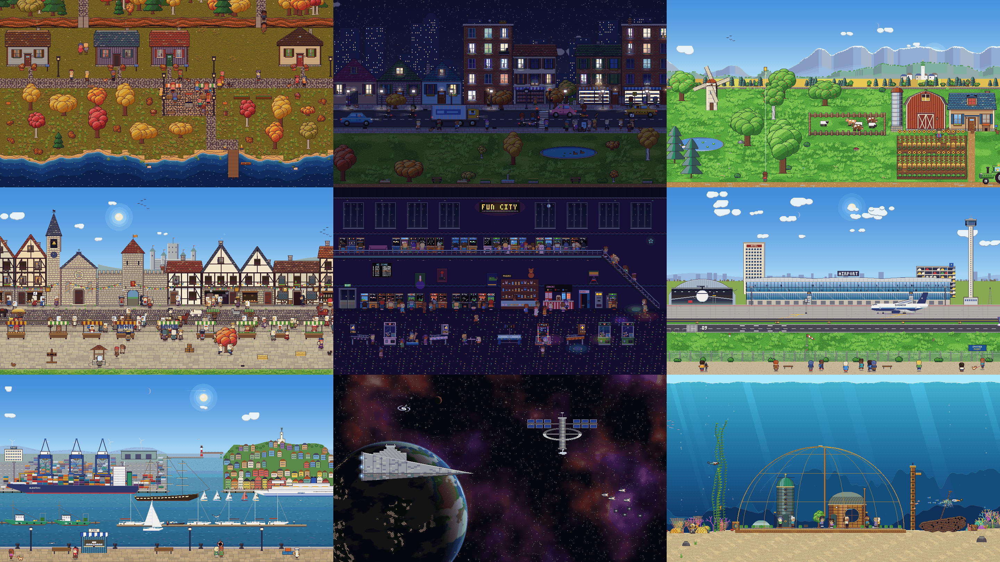

# Pixel Life Wallpaper

A GNOME Shell extension that turns the desktop background into a living
pixel-art scene in a cozy retro style.



- **Village by the lake (default):** seen from above, with a
  cliff and forest, cottages, a plaza with fountain or well and a market,
  flowering meadows, a lake with a pier, fishing villagers, ducks, cats,
  crows, festivals and fireworks.
- **Big city (side view):** cottages, town houses with shops, apartment blocks and towers.
  Every household follows its own routine, so lights go on and off and people
  cook, watch TV, party or wave at the window. Traffic with a bus, police
  chases and an ice cream van; pedestrians with dogs, umbrellas and balloons;
  a park with a fountain.
- **Countryside (side view):** a farm with crops by season, cows, sheep, chickens, a pond
  with ducks, a windmill, a steam train, deer and foxes at dusk, grass that
  rustles where they run and bends under the gusts.
- **Medieval town (side view):** a castle on the hill, the town wall and gate,
  half-timbered houses with shops and guild signs, a church, a tavern and a
  smithy, market days with stalls, carts, riders and herds. The day follows
  the church bells: the gate opens at the morning bell, the curfew at nine
  sends everybody home and the night watchman calls the hours. Maypole,
  midsummer fire, autumn fair and advent come with the calendar.
- **Retro arcade hall:** a gallery under high windows, a neon sign, rows of
  upright cabinets with little games on their screens, pinball, air hockey,
  claw machines, a dance machine, a kiddie ride, the prize counter, a snack
  bar and a photo booth. The hall keeps opening hours; guests change money
  for tokens, play, cheer at a new high score and go home. Friday and
  Saturday nights are disco nights on the blacklight carpet. Umbrellas stay
  in the stand at the door.
- **Airport (side view):** the terminal with jet bridges, the tower, a
  radar, a hangar, a hotel and the car park. Planes of six types land into
  the wind, taxi in, are unloaded, fuelled and catered, pushed back and take
  off again; quiet nights with the odd cargo flight, go-arounds, a water
  salute, snow ploughs, spotters at the fence and hares in the grass.
- **Harbor (side view):** a container terminal whose gantry cranes unload
  and load the ship box by box until it leaves with a tug and the next one
  comes in, the old town on the hill with its ferry pier, the mole with a
  lighthouse sweeping the night, ships passing on the horizon. Fishing
  cutters go out at dawn and come home with the gulls; a marina, a tall
  ship, regattas, anglers, a fish kiosk and gulls on the bollards of the
  promenade. Every ship is drawn at the scale of the water it is in.
- **Space:** a nebula, a planet whose day side turns with the clock, a ring
  station with docking shuttles, fighter patrols and dogfights, huge cruisers,
  freighters jumping to hyperspace, comets and asteroids.
- **Under the sea:** a big brass and glass dome with Nautilus style iron and
  copper houses and people living inside, helmet divers outside, a riveted submarine docking at its
  tower, merfolk who wave, knock on the glass and hunt fish, fish schools,
  turtles, jellyfish, kelp, coral, a wreck and a kraken that now and then
  swims by or settles on the dome.
- Day and night follow your clock and calendar, sunrise and sunset fit the
  latitude of your time zone; seasons, weather (rain,
  storms, snow, fog, rainbows) with wind in the grass and the trees,
  holidays and many random events.
- Sliders for how many people and vehicles are about, from empty to twice as busy.
- Optional clock overlay: info box, digital or analog.
- Pauses while a maximized or fullscreen window covers the monitor.

Requires GNOME Shell 48, 49 or 50.

## Install from source

```bash
./tools/pack.sh
gnome-extensions install --force dist/pixel-life@garfieldttt.github.io.shell-extension.zip
```

Log out and back in (Wayland), then enable it in the Extensions app.

## Development

`preview/index.html` runs the same engine in a browser with controls for
time, speed, season, weather and events:

```bash
python3 -m http.server 8000   # then open http://localhost:8000/preview/
```

`node tools/snap.mjs city 2026-10-24T21:00 clear out.png` renders a single
frame; `node tools/stress.mjs` runs all scenes, seasons, weathers and events.

## License

GPL-2.0-or-later
